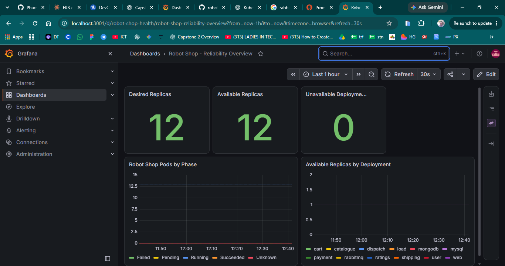
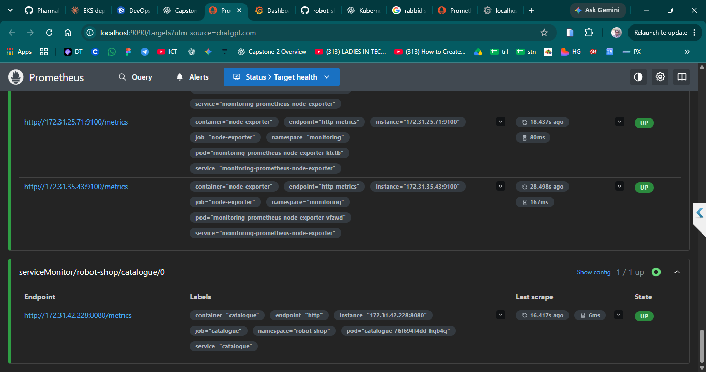
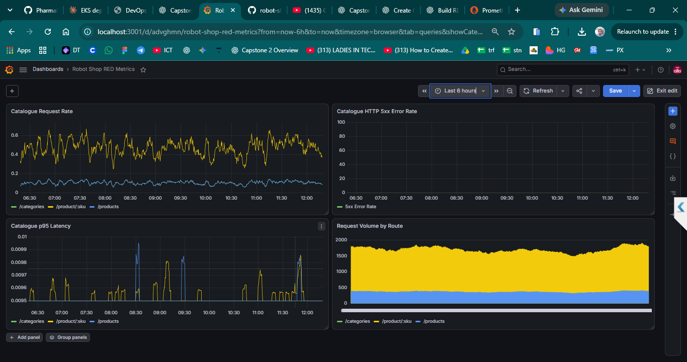

# Capstone 2: Stan's Robot Shop — Observability & Reliability

This capstone deploys **Stan's Robot Shop** to Amazon EKS and builds practical observability skills using metrics, centralized logging, distributed tracing, Service Level Objectives (SLOs), and error budgets. The documentation separates completed work from planned or unverified components so that diagrams and configuration are not mistaken for live evidence.

## Project Environment

- **Application:** Stan's Robot Shop microservices
- **Platform:** Amazon EKS / Kubernetes
- **Deployment:** Helm
- **Metrics and alerting foundation:** Prometheus and Prometheus Operator
- **Visualization:** Grafana
- **Logging backend:** Loki (deployed; end-to-end ingestion not verified)
- **Log collector:** Fluent Bit (deployment unhealthy at last check)
- **Planned tracing backend:** Grafana Tempo
- **Planned trace pipeline:** OpenTelemetry Collector and instrumented Robot Shop services
- **Persistent storage:** AWS EBS CSI driver with `gp3` volumes
- **Namespace:** `robot-shop` for the application and `monitoring` for observability components

## What Has Been Implemented

### 1. Robot Shop on EKS

- Worked from a fork of the Robot Shop repository.
- Deployed the microservices into the `robot-shop` namespace using Helm.
- Inspected pods, deployments, services, events, and scheduling behavior while troubleshooting.
- Used `helm lint` and `helm template` to validate chart structure and inspect rendered Kubernetes resources.

### 2. Prometheus and Grafana

- Deployed the Prometheus/Grafana monitoring stack in the `monitoring` namespace.
- Created the **Robot Shop - Reliability Overview** dashboard.
- Added panels for desired replicas, available replicas, unavailable deployments, pod phases, and available replicas by deployment.
- Loaded or configured Prometheus rules for detecting unavailable Robot Shop deployment replicas.
- Created the **Robot Shop RED Metrics** dashboard to explore request rate, HTTP 5xx error rate, p95 latency, and request volume by route.

### 3. Catalogue Metrics Scraping

- Verified that the Catalogue service exposes metrics at `/metrics` on port `8080`.
- Identified metrics including `http_requests_total` and `http_request_duration_seconds`.
- Configured Prometheus discovery for the Catalogue `ServiceMonitor` using the monitoring release label.
- Observed `serviceMonitor/robot-shop/catalogue/0` in the **UP** state, with its endpoint responding successfully at the time of capture.

### 4. Centralized Logging — In Progress

- Deployed Loki in the `monitoring` namespace. At the last recorded check, `loki-0` was `2/2 Running` and its 10 GiB `gp3` persistent volume was `Bound`.
- Created `monitoring/logging/loki-values.yaml` and `monitoring/logging/fluent-bit-values.yaml`.
- Validated that Helm could render the Fluent Bit chart.
- Attempted to deploy Fluent Bit as a DaemonSet. At the last check, one Fluent Bit pod was in `CrashLoopBackOff` and three were `Pending`.
- Therefore, successful end-to-end log delivery from Robot Shop to Loki has **not** been verified. The project is not scaling the cluster just to force this component to run; capacity and cost must be considered first.

#### Intended logging flow

`Robot Shop container logs → Fluent Bit → Loki → Grafana Explore`



> **Illustration only:** this is a conceptual diagram, not a screenshot of a working pipeline. Fluent Bit still needs to become healthy and logs must be found in Grafana Explore before logging can be marked complete.

Example LogQL queries to use after ingestion is verified:

```logql
{namespace="robot-shop"}
```

```logql
{namespace="robot-shop"} |~ "(?i)error|exception|failed"
```

### 5. Distributed Tracing — Planned

The planned tracing architecture is:

`Instrumented Robot Shop services → OpenTelemetry Collector → Grafana Tempo → Grafana`

The proposed Tempo configuration is in `monitoring/tracing/tempo-values.yaml`. The earlier `grafana/tempo` chart render produced a deprecation warning, so the chart reference and values schema must be validated against a supported chart before deployment. The collector, application instrumentation, Grafana data source, and end-to-end trace query are not yet verified.


> **Illustration only:** the diagram describes the intended design. It does not prove Tempo or the collector has been deployed, or that Robot Shop is currently producing traces.

See [`monitoring/docs/tracing.md`](monitoring/docs/tracing.md) for the deployment plan and verification checklist.

### 6. SLOs and Error Budget — Defined as Proposed Targets

The project documentation proposes the following initial learning targets:

| Indicator | Proposed target | Window |
|---|---|---|
| Availability | 99.5% | 30 days |
| Eligible request success rate | At least 99.5% | 30 days |
| Request latency | 95% of eligible requests within 500 ms | 30 days |

These are **proposed targets, not measured or achieved SLOs**. The exact eligible requests, Prometheus metric names, histogram buckets, and queries must be validated before calculating actual compliance.

For a 99.5% availability SLO, the error budget is `100% - 99.5% = 0.5%`. Over a 30-day period of 43,200 minutes, that corresponds to 216 minutes (3 hours 36 minutes) of downtime. This is a time-based illustration; a request-based SLO must calculate the budget from eligible request counts and failed requests instead.

- [`monitoring/docs/slo.md`](monitoring/docs/slo.md) — proposed SLOs and SLIs.
- [`monitoring/docs/error-budget.md`](monitoring/docs/error-budget.md) — error-budget calculations and suggested response policy.
- [`monitoring/docs/observability-status.md`](monitoring/docs/observability-status.md) — implementation status and completion checklist.

## Evidence

### Grafana — Robot Shop Reliability Overview

At the time this screenshot was captured, the dashboard showed 12 desired replicas, 12 available replicas, and 0 unavailable deployments, alongside pod-phase and per-deployment replica panels.


### Prometheus — Catalogue ServiceMonitor UP

The captured target page shows `serviceMonitor/robot-shop/catalogue/0` in the **UP** state and scraping the Catalogue `/metrics` endpoint.



### Grafana — Robot Shop RED Metrics

The dashboard includes Catalogue request rate, HTTP 5xx error rate, p95 latency, and request volume by route. The error-rate panel is currently empty in the captured time range; this should be treated as no plotted samples in that panel, not as proof that the error rate is zero under all conditions.



> **Captured evidence:** This screenshot shows the `Robot Shop RED Metrics` dashboard over the last 6 hours. Request rate and request volume are plotted by route. The HTTP 5xx error-rate panel has no plotted series in this view, so this screenshot alone does not establish a zero error rate. The p95 latency panel shows sparse values around 0.0095–0.010 seconds for the plotted series; validate the query, units, and histogram calculation before treating this as a definitive latency SLI.

## Resource and Cost Considerations

The EKS environment has limited capacity, and the monitoring stack itself consumes CPU, memory, and persistent storage. Fluent Bit pods were Pending or crashing at the last check, and Loki Canary pods also had Pending instances. Before deploying Tempo or more collectors:

1. Inspect node and pod resource usage.
2. Check Pending and CrashLoopBackOff pod events and logs.
3. Validate Helm templates before installation.
4. Avoid scaling worker nodes or adding workloads without considering cost.
5. Mark components complete only after verifying their actual behavior.

Useful commands:

```bash
kubectl get nodes
kubectl top nodes
kubectl get pods -n monitoring -o wide
kubectl get pvc -n monitoring
kubectl get events -n monitoring --sort-by='.lastTimestamp' | tail -25
```

If `kubectl top nodes` is unavailable, resource metrics may not be exposed through that command.

## Knowledge Gained

- **Kubernetes health:** inspecting pods, deployments, services, events, and scheduling failures.
- **Helm:** validating charts with `helm lint`, rendering manifests with `helm template`, and separating chart configuration from runtime health.
- **Prometheus scraping:** a target marked `UP` indicates that the scrape endpoint responded successfully at the time of the check.
- **ServiceMonitor discovery:** Prometheus Operator uses `ServiceMonitor` resources and selectors to discover endpoints.
- **Application metrics:** request counters and latency histograms help analyze traffic, errors, and performance.
- **Grafana dashboards:** visualizing infrastructure health and RED signals (Rate, Errors, Duration).
- **Logging architecture:** Fluent Bit collects container logs, Loki stores/query them, and Grafana Explore provides log search; end-to-end delivery remains unverified.
- **Tracing architecture:** OpenTelemetry transports traces to Tempo for exploration in Grafana; deployment and instrumentation remain planned.
- **SLOs and error budgets:** defining measurable reliability targets and calculating the allowed unreliability.
- **Capacity-aware operations:** investigating resource pressure before adding more workloads to a limited cluster.

## Current Status Summary

| Area | Status | Evidence / next step |
|---|---|---|
| Robot Shop on EKS | Implemented previously | Check current workload health before final submission |
| Prometheus and Grafana | Deployed previously | Dashboard screenshots included |
| Catalogue metrics | Verified at time of capture | ServiceMonitor target was UP |
| RED dashboard | Created | Screenshot included; validate queries over the intended window |
| Loki | Deployed; pod and PVC previously healthy | Verify current health and log ingestion |
| Fluent Bit | Not healthy at last check | Investigate Pending and CrashLoopBackOff states |
| SLOs | Proposed/documented | Validate SLI queries and measure compliance |
| Error budget | Calculation documented | Calculate actual consumption from verified SLI data |
| Tempo / tracing | Planned, not verified | Validate chart, deploy when capacity allows, configure collector and instrumentation |
| Slack alerting and runbook | Outstanding | Implement and test an alert route and linked runbook |
| Incident drill / postmortem | Outstanding | Run an exercise and document lessons learned |

## Useful Commands

```bash
# Robot Shop workloads
kubectl get pods -n robot-shop
kubectl get deployments -n robot-shop
kubectl get services -n robot-shop

# Monitoring workloads and Fluent Bit
kubectl get pods -n monitoring -o wide
kubectl get daemonset fluent-bit -n monitoring
kubectl logs -n monitoring daemonset/fluent-bit --tail=100

# Validate/render the Robot Shop Helm chart (adjust path if your repository differs)
helm lint K8s/helm
helm template robot-shop K8s/helm --namespace robot-shop

# Recent application events
kubectl get events -n robot-shop --sort-by='.metadata.creationTimestamp'
```

## Project Goal

The goal is not just to run Robot Shop, but to understand service health through metrics, logs, and traces; define measurable reliability objectives; alert on failures; and practise responding to incidents. This README records both the evidence collected and the work that remains, without presenting planned components as completed.
